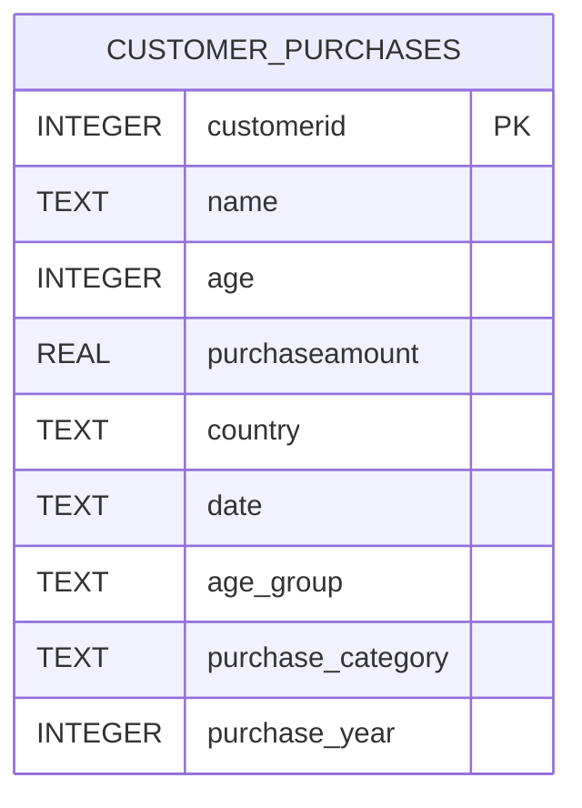

# Entity relationship model

One synthetic purchase per CustomerID is generated for this teaching example. CustomerID is unique. A production system would separate customers and purchases into two tables with a one-to-many relationship.
